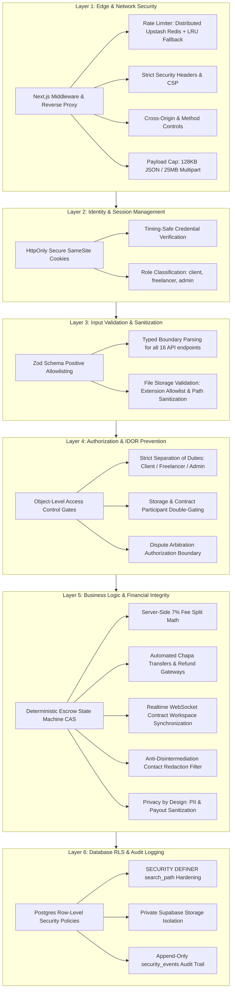

# MudayHub Freelance: Security by Design & Defense-in-Depth Architecture

This document specifies the end-to-end security architecture of the MudayHub freelance platform, detailing how **Security by Design** principles and a **6-Layer Defense-in-Depth** strategy are engineered into every layer of the system.

---

## 1. Executive Summary & Core Principles

MudayHub is a high-trust digital services and escrow marketplace designed for the Ethiopian tech ecosystem. Security cannot be an afterthought; financial transactions, intellectual property deliverables, and user identities require robust, resilient defenses.

### Core Security by Design Principles
1. **Zero Trust Architecture:** Every request is authenticated, authorized, and validated regardless of whether it originates from a browser client or an internal component.
2. **Principle of Least Privilege:** Users (clients, freelancers, admins) and service accounts possess only the minimal privileges required to complete their immediate actions.
3. **Defense in Depth:** Multiple independent security barriers protect critical assets. If any layer fails or is bypassed, subsequent layers prevent compromise.
4. **Fail-Safe Defaults:** Systems default to denial. Access is denied unless explicitly permitted; unhandled states halt execution safely.
5. **Data Minimization & Privacy by Design:** Private Personally Identifiable Information (phone numbers, Telebirr numbers, emails) is never broadcast to public discovery endpoints or third parties.
6. **Non-Repudiation & Tamper-Resistant Auditing:** All privileged and financial state mutations produce auditable, immutable logs.

---

## 2. Threat Modeling & STRIDE Analysis

| Threat Category | Potential Attack Vector | MudayHub Mitigation Control | Defense Layer |
| :--- | :--- | :--- | :--- |
| **Spoofing** | Attacker impersonates a legitimate client or admin to release escrow funds | HttpOnly SameSite session cookies, timing-safe credential verification, HMAC-SHA256 signed payment provider webhooks | Layers 1, 2 |
| **Tampering** | Attacker alters bid amount, platform fee, or escrow transition state | Server-side fee computation (`calcFeeSplit`), strict Escrow State Machine CAS (`assertTransition`), immutable Postgres triggers | Layers 3, 5, 6 |
| **Repudiation** | Client or admin denies raising a dispute or authorizing a payout release | Append-only `public.security_events` table and audited `contract_events` logging each state change with actor identity and timestamp | Layers 5, 6 |
| **Information Disclosure** | Scraping public directory to harvest freelancer phone numbers and Telebirr accounts | `get_public_profiles()` Postgres SECURITY DEFINER view and `sanitizePublicProfile()` data transformer filtering PII | Layers 4, 5, 6 |
| **Denial of Service** | Flooding auth, checkout, or file storage endpoints | Multi-instance distributed Redis rate limiter with local LRU fallback (5,000 bucket cap), 128KB JSON cap, 25MB file upload cap | Layer 1 |
| **Elevation of Privilege** | Freelancer submits admin dispute decision or promotes own profile to admin | Route-level role guards (`role === 'admin'`), Postgres RLS policies, and trigger `profiles_guard_privileged` blocking self-escalation | Layers 2, 4, 6 |

---

## 3. The 6-Layer Defense-in-Depth Architecture

### Layer 1: Edge & Network Security
- **Multi-Instance Distributed Rate Limiting (`middleware.ts` & `lib/security/ratelimit.ts`):**
  - Sliding 60-second window enforced per IP + endpoint + HTTP method.
  - Powered by Upstash Redis REST pipeline for seamless horizontal scaling across serverless nodes.
  - Automatic graceful degradation to a local bounded in-memory LRU rate limiter (5,000 buckets) if Redis is unavailable or unconfigured.
  - Strict auth rate limit: **10 req/min** on `/api/auth/*`.
  - Storage upload rate limit: **30 req/min** on `/api/storage/upload`.
  - Mutation rate limit: **60 req/min** for `POST`, `PUT`, `PATCH`, `DELETE`.
  - Read rate limit: **240 req/min** for `GET`.
- **Protocol & Method Controls:**
  - Dangerous HTTP methods (e.g. `TRACE`, `TRACK`) are immediately rejected with `405 Method Not Allowed`.
  - Content-Type enforcement: Mutation requests with payloads must declare `application/json` (or `multipart/form-data` on `/api/storage/upload`).
  - Strict payload caps: 128 KB for JSON requests, 25 MB for deliverable file uploads.
- **Cross-Origin Request Protection (CSRF):**
  - Origin validation: Mutation requests verify that `Origin` matches `request.nextUrl.origin`.
  - Fallback validation: When `Origin` is omitted, `Referer` origin is checked against `nextUrl.origin`.
  - `Sec-Fetch-Site` inspection: Browser requests marked `cross-site` are blocked immediately (`403 Forbidden`).
- **HTTP Security Headers (`next.config.ts` & `middleware.ts`):**
  - `X-Content-Type-Options: nosniff` (MIME sniffing prevention)
  - `X-Frame-Options: DENY` (Clickjacking mitigation)
  - `X-XSS-Protection: 0` (Modern standard disabling vulnerable legacy auditor)
  - `Cross-Origin-Opener-Policy: same-origin` (Spectre & window-interaction mitigation)
  - `Referrer-Policy: strict-origin-when-cross-origin` (Leak prevention)
  - `Permissions-Policy: camera=(), microphone=(), geolocation=(), payment=()`
  - `Strict-Transport-Security: max-age=31536000; includeSubDomains` (HSTS)
  - Comprehensive `Content-Security-Policy` restricting script, style, image, object, and frame domains.

---

### Layer 2: Identity & Session Management
- **Session Security (`lib/auth/session.ts`):**
  - Cookie attributes: `HttpOnly`, `SameSite=Lax`, and `Secure` (when served over HTTPS).
  - Production sessions rely on Supabase Auth JWTs with cryptographic verification.
  - Demo session store uses randomly generated UUIDv4 tokens stored in HttpOnly cookies.
- **Timing-Attack Resistance (`lib/demo/store.ts` & `chapa.ts`):**
  - Credential and HMAC signature comparisons utilize `crypto.timingSafeEqual` over fixed-length buffer representations to prevent side-channel timing analysis.
- **Role-Based Access Control (RBAC):**
  - Distinct identities: `client`, `freelancer`, `admin`.
  - New user signups default to `freelancer` or `client`; the `admin` role can never be self-assigned.

---

### Layer 3: Input Validation & Sanitization
- **Positive Allowlisting via Zod (`lib/security/validation.ts`):**
  - Every API endpoint validates incoming payloads through strict Zod schemas with `.strict()` mode enabled, rejecting undeclared or prototype-polluting keys.
  - Endpoints protected by typed schemas:
    1. `loginSchema`: Validates email (max 254 chars) and password (8-256 chars).
    2. `registerSchema`: Extends login with full name, role enum, and Ethiopian phone format validation (`+2519...` / `+2517...`).
    3. `jobSchema`: Validates title, category, budget bounds (100 - 10,000,000 ETB), and skills array bounds.
    4. `proposalSchema`: Validates bid amount (50 - 10,000,000 ETB), duration (1 - 365 days), and cover letter.
    5. `gigSchema` & `gigPackageSchema`: Multi-tier package validation with price, delivery days, and revision caps.
    6. `orderGigSchema`: Validates package tier (`basic`, `standard`, `premium`) and requirements text length.
    7. `messageSchema`: Validates contract ID and maximum message body length (4,000 chars).
    8. `escrowCheckoutSchema`: Validates contract ID target.
    9. `escrowSubmitWorkSchema`: Validates secure HTTPS deliverable URL or internal storage download reference.
    10. `escrowReleaseSchema`: Validates contract ID target.
    11. `escrowDisputeSchema`: Enforces minimum 10-character reason and optional evidence link.
    12. `adminResolveDisputeSchema`: Enforces dispute status transitions and outcome options (`release` / `refund`).
    13. `reviewSchema`: Enforces integer rating (1 to 5) and comment constraints.
    14. `profileUpdateSchema`: Enforces phone and Telebirr format validation.
    15. `notificationPatchSchema`: Validates arrays of notification IDs.
    16. `revisionRequestSchema`: Validates revision note length.
- **Deliverable File Storage Validation (`lib/storage/index.ts`):**
  - Strict extension allowlist: `.pdf`, `.zip`, `.tar.gz`, `.png`, `.jpg`, `.docx`, `.mp4`, `.fig`, etc.
  - Explicit denylist blocking executables, shell scripts, and HTML/PHP scripts (`.exe`, `.sh`, `.php`, `.js`, `.html`, `.apk`).
  - Path traversal and control character sanitization stripping `../` and null bytes.
  - Hard 25MB maximum upload limit.

---

### Layer 4: Authorization & Object-Level Access Control (IDOR Prevention)
- **Double-Gated Access Control:**
  - Authorization is verified at both the application route layer AND the database RLS layer.
  - `/api/contracts/[id]`: Verifies caller is the contracting client, freelancer, or platform admin before returning details.
  - `/api/messages`: Verifies sender is an active participant in the associated contract.
  - `/api/storage/upload` & `/api/storage/download`: Verifies caller is a participant of the associated contract or admin.
  - `/api/gigs/[id]` (DELETE): Ensures only the gig creator or platform admin can delete a listing.
  - `/api/admin/disputes`: Access restricted exclusively to verified administrators (`role === 'admin'`).
  - Self-dealing prevention: Clients cannot submit proposals on their own jobs, and freelancers cannot order their own gigs.

---

### Layer 5: Business Logic, Financial Integrity & Realtime UX
- **Deterministic Escrow State Machine (`lib/escrow/state-machine.ts`):**
  - State transitions are strictly enforced via `assertTransition()`. Illegal state hops are rejected with `400 Bad Request`.
  - Webhook funding uses Compare-And-Swap (CAS) to prevent double-crediting on retried or raced webhook requests.
- **Live Automated Payment Gateways (`lib/escrow/gateways/chapa.ts`):**
  - Real integration with Chapa Transfers API (`https://api.chapa.co/v1/transfers`) for automated freelancer disbursements.
  - Real integration with Chapa Refund API (`https://api.chapa.co/v1/transaction/refund`) for automated client dispute resolutions.
  - Dynamically reports capabilities based on `CHAPA_ENABLE_PAYOUTS` and `CHAPA_ENABLE_REFUNDS` flags.
- **Realtime Escrow Contract Workspace:**
  - Supabase Realtime channel subscription listening to `contracts` and `disputes` changes.
  - Automatic visibility-aware polling fallback in demo mode so clients and freelancers see state updates without manual reloads.
- **Server-Side Fee Integrity (`lib/utils.ts` & `lib/escrow/fees.ts`):**
  - Platform fee is fixed at 7% (`PLATFORM_FEE_RATE = 0.07`).
  - Deterministically calculated on the server and in PostgreSQL functions.
- **Anti-Disintermediation Filter (`lib/messaging/filter.ts`):**
  - Until escrow is funded (`awaiting_deposit`), direct contact info (Ethiopian phones, emails, social handles, external payment rails) is redacted.
- **Privacy by Design (`lib/security/privacy.ts`):**
  - `sanitizePublicProfile()` strips private contact numbers (`phone`, `telebirr_number`, and `email`) before exposing profile data to public directories or unauthenticated users.

---

### Layer 6: Database Security, Row-Level Security & Audit Logging
- **Postgres Row-Level Security (RLS):**
  - Enabled on all tables: `profiles`, `jobs`, `proposals`, `contracts`, `disputes`, `messages`, `notifications`, `gigs`, `reviews`, `payment_operations`, `contract_events`, and `security_events`.
  - Sensitive operations execute inside `SECURITY DEFINER` functions with fixed `search_path = public`, with public execution permissions revoked and granted solely to `service_role`.
- **Privilege Escalation Guard Trigger (`002_production_hardening.sql`):**
  - Database trigger `profiles_guard_privileged` blocks any authenticated user from modifying their own `role`, `is_verified`, or `rating` columns.
- **Append-Only Security Audit Trail (`lib/security/audit.ts` & `006_security_audit.sql`):**
  - Table `public.security_events` records structured events for sensitive operations:
    - Authentication events: `auth.login.success`, `auth.login.failure`, `auth.register.success`, `auth.logout`
    - Escrow financial events: `escrow.checkout.created`, `escrow.webhook.verified`, `escrow.webhook.invalid_signature`, `escrow.webhook.amount_mismatch`, `escrow.funds.released`
    - Arbitration events: `escrow.dispute.opened`, `admin.dispute.review_started`, `admin.dispute.resolved`
    - Storage events: `storage.file_uploaded`, `storage.file_downloaded`, `storage.upload.forbidden_attempt`, `storage.download.forbidden_attempt`
  - Sensitive metadata (passwords, JWTs, card numbers, private keys) is scrubbed before audit insertion.

---

## 4. Verification Matrix & E2E Security Tests

All 13 core security guards and lifecycle paths have been verified via end-to-end integration testing (`scripts/e2e_test.py`):

| Test ID | Security Guard Verified | Mechanism | Result |
| :---: | :--- | :--- | :--- |
| **G-01** | Role-based authentication & session isolation | Cookie-based session resolution, role verification | **PASS** |
| **G-02** | Authorized job posting & parameter validation | Zod schema validation, client-role restriction | **PASS** |
| **G-03** | Freelancer-only proposal bidding | Role verification, positive duration and bid limits | **PASS** |
| **G-04** | Atomic proposal acceptance & contract creation | Single transaction state change, server 7% fee calculation | **PASS** |
| **G-05** | Pre-funding anti-disintermediation redaction | Regex filter masking phone and social handles | **PASS** |
| **G-06** | Mock payment gateway checkout session creation | Gateway abstraction, contract ownership check | **PASS** |
| **G-07** | HMAC-SHA256 signed payment webhook processing | Timing-safe HMAC verification, CAS state update | **PASS** |
| **G-08** | Unsigned or tampered webhook rejection | Signature validation rejecting unsigned requests with 401 | **PASS** |
| **G-09** | Freelancer deliverable submission & validation | Secure URL/storage link enforcement, 72h review window transition | **PASS** |
| **G-10** | Post-funding redaction lift | Status check lifting redaction once funds are locked | **PASS** |
| **G-11** | Escrow release role guard | Only contracting client or admin can release funds (403 on freelancer) | **PASS** |
| **G-12** | Telebirr payout execution & reputation update | Net payout dispatch, profile rating update | **PASS** |
| **G-13** | Dispute opening & administrative arbitration | Mutual freeze, admin role gate, resolution release/refund | **PASS** |

---

## 5. Security Checklist for Production Deployment

1. **Rotate Secrets:** Ensure `SUPABASE_SERVICE_ROLE_KEY`, `CHAPA_SECRET_KEY`, and `CHAPA_WEBHOOK_SECRET` are stored in secure secret managers.
2. **Apply All SQL Migrations:** Ensure migrations `001` through `006` are executed sequentially in PostgreSQL.
3. **Provision Private Storage Bucket:** Create private bucket `contract-files` in Supabase Storage with RLS enabled.
4. **Configure Distributed Rate Limiter:** Set `UPSTASH_REDIS_REST_URL` and `UPSTASH_REDIS_REST_TOKEN`.
5. **Log Sinks & Alerting:** Route `public.security_events` and application stdout to a monitored SIEM / log sink (e.g., Datadog, CloudWatch, GCP Cloud Logging).
6. **Enforce HTTPS / HSTS:** Ensure edge termination uses TLS 1.3 with automated certificate renewal.
